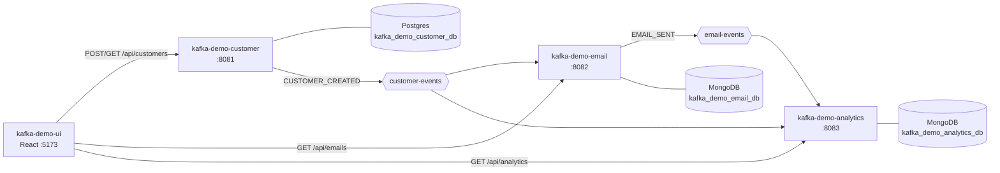

# Architecture

## The Kafka Demo system

| Repo | Role | Port | Data store |
|---|---|---|---|
| kafka-demo-customer | Owns customers, publishes `customer-events` | 8081 | Postgres |
| kafka-demo-email | Sends a welcome email per new customer, publishes `email-events` | 8082 | MongoDB |
| kafka-demo-analytics | Counts every event on `customer-events` and `email-events` | 8083 | MongoDB |
| kafka-demo-ui | React UI over all three | 5173 | — |
| local-docker | Kafka, Postgres, MongoDB for local dev | — | — |

## This service: kafka-demo-analytics

Listens to every event on `customer-events` and `email-events`, stores each one in MongoDB, and serves counts by event type.

- **Produces:** — (only DLQ records)
- **Consumes:** `customer-events`, `email-events` (group `kafka-demo-analytics`)
- **Stores:** MongoDB

## Design decisions

- **Envelope only.** `AnalyticsEventListener` reads `eventId`, `eventType`, `occurredAt` and
  `customerId`, so any new event type on a subscribed topic is counted with no code change.
  Add a topic by appending it to `app.kafka.topics`.
- **Idempotent on `eventId`**, which is the document `_id`; a redelivery hits a duplicate key and is skipped.
- **Counts are computed on read** with a `$group` aggregation. Fine for a demo; pre-aggregate if volume grows.
- **Retries then DLQ** to `<topic>-dlq`; malformed events skip the retries.

## Known gaps

- No time-bucketed metrics (per day/hour).
- No Testcontainers integration tests yet.
