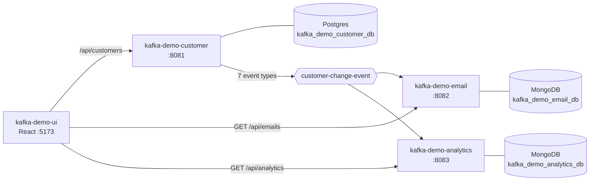

# Architecture

## The Kafka Demo system

| Repo | Role | Port | Data store |
|---|---|---|---|
| kafka-demo-customer | Owns customers and phones, publishes `customer-change-event` | 8081 | Postgres |
| kafka-demo-email | Sends an email for each customer change | 8082 | MongoDB |
| kafka-demo-analytics | Saves every event on `customer-change-event` | 8083 | MongoDB |
| kafka-demo-ui | React UI over all three | 5173 | — |
| local-docker | Kafka, Postgres, MongoDB, Keycloak for local dev | — | — |

## This service: kafka-demo-analytics

Listens to `customer-change-event`, saves each event in MongoDB exactly as it arrived, and serves counts by event type.

- **Produces:** — (only DLQ records)
- **Consumes:** `customer-change-event` (group `kafka-demo-analytics`)
- **Stores:** MongoDB

## Design decisions

- **Saves the event as received.** `EventRecordingService` reads only `eventId`, `eventType`, `occurredAt` and
  `customerId`, and stores the whole payload as a string, so a new event type needs no code change.
  Add a topic by appending it to `app.kafka.topics`.
- **Idempotent on `eventId`**, which is the document `_id`; a redelivery hits a duplicate key and is skipped.
- **Counts are computed on read** with a `$group` aggregation. Fine for a demo; pre-aggregate if volume grows.
- **Retries then DLQ** to `<topic>-dlq`; malformed events skip the retries.

## Known gaps

- No time-bucketed metrics (per day/hour).
- The saved payload holds names, email addresses and phones.
